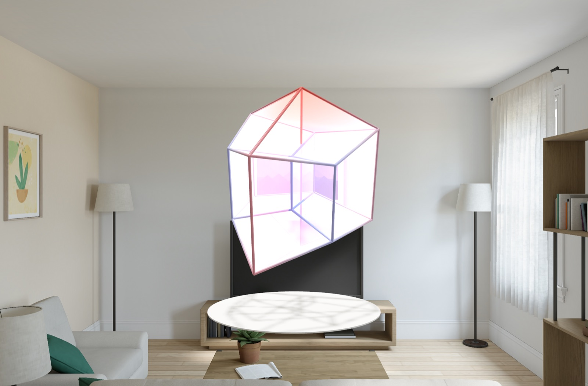
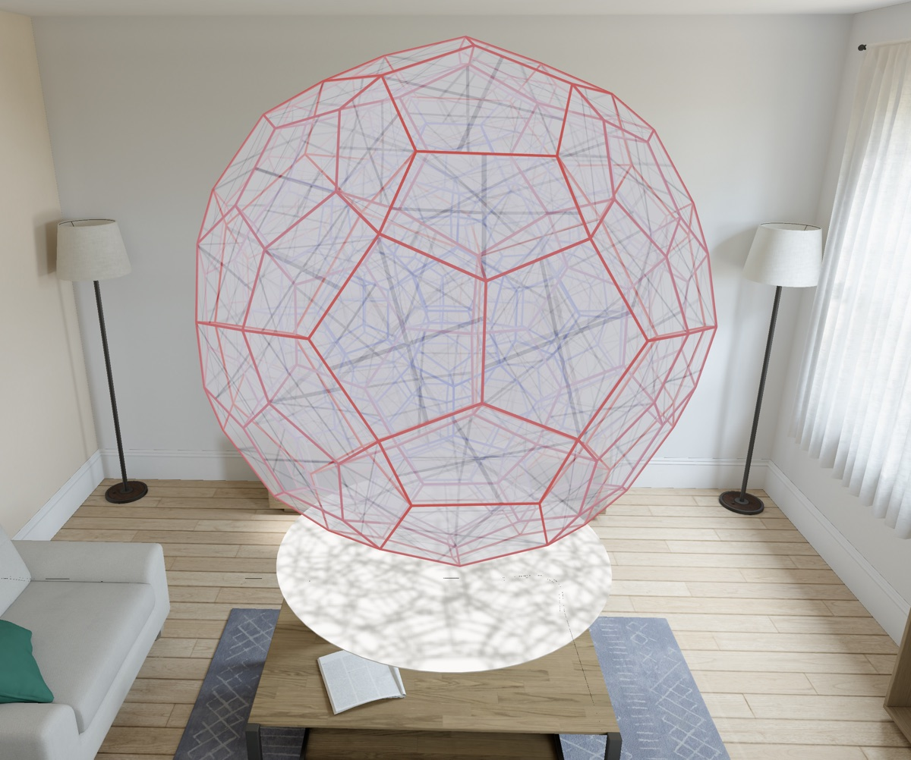
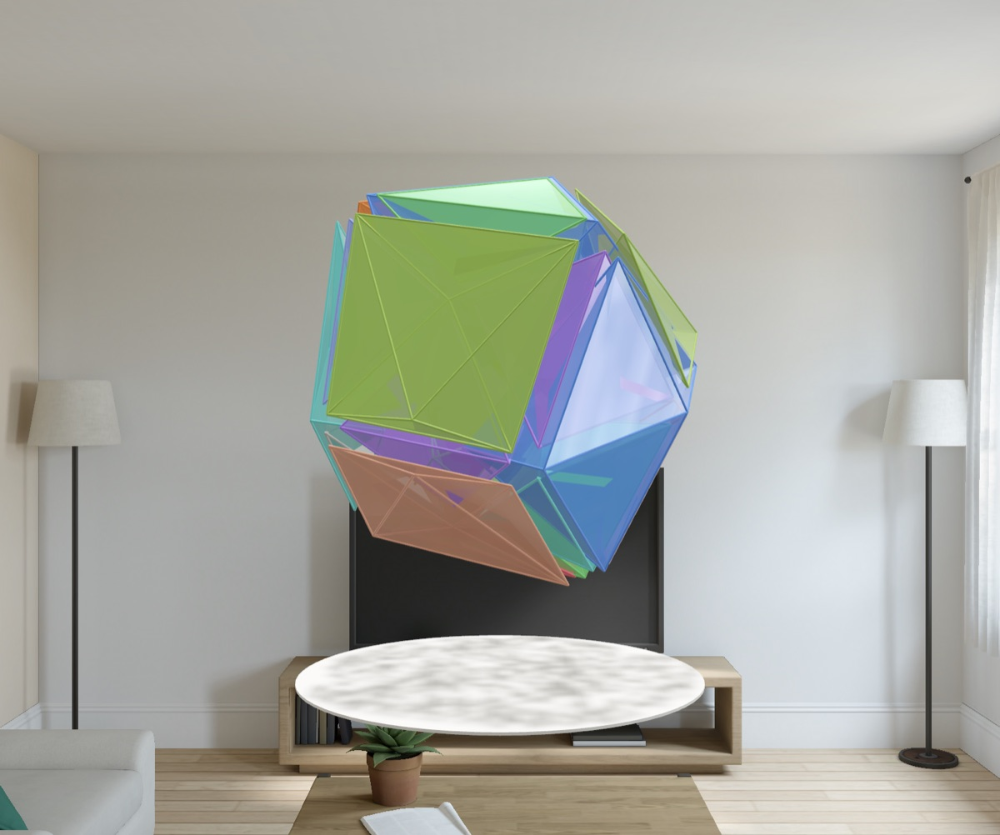
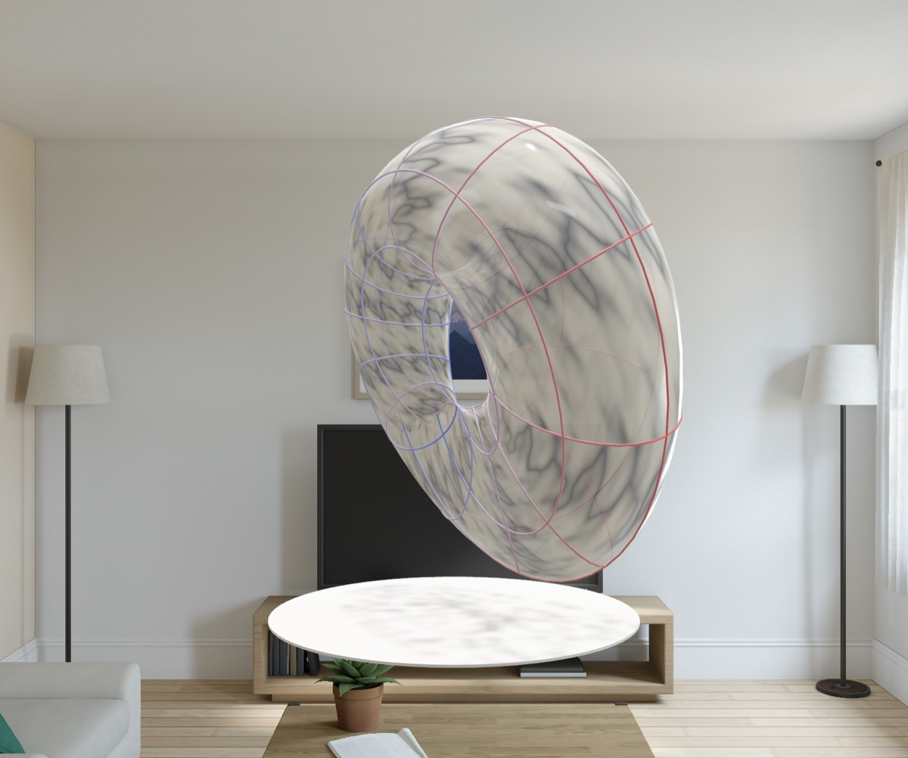
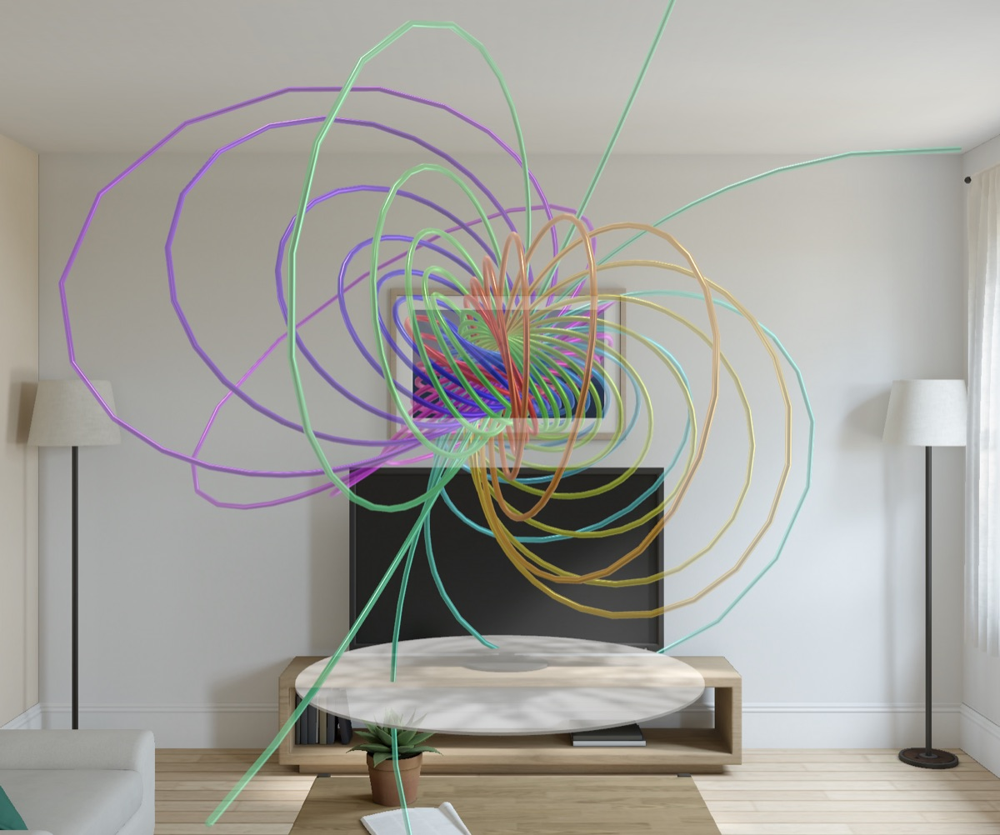

# Shadow43

**The shadows of four-dimensional objects, in your room.** A cube casts a flat shadow; a
four-dimensional object casts a three-dimensional one. Shadow43, an app for Apple Vision Pro, shows
this shadow of an object in 4-dimensional space as a stereoscopic object in 3D that you can walk around. 
It lets you turn the 4D object with your hands and have it rotate in 4 dimensions. The shadow deforms, 
turns inside out and passes through itself, while the object itself stays rigid.



## Copyright and AI notice

© 2026 Andreas Keese, licensed under Apache 2.0. Provided as is, without warranty of any kind:
it may contain bugs, and it is a personal project, not an App Store product.

Shadow43 was built by agentic coding: Claude (Opus 5.5), working in [Claude Code](https://claude.com/claude-code), 
wrote the code, the tests and the design document, and tested the app in the visionOS simulator. 
I set the direction, made the decisions, reviewed the work and tested the app on an Apple Vision Pro.

## What it does

- **Ten objects:** the six regular 4D polytopes (5-cell, tesseract, 16-cell, 24-cell, 120-cell,
  600-cell), duoprisms p × q, the Klein bottle, the Clifford torus and the Hopf fibration.
- **Turn them by hand:** pinch and drag to turn in 4D, let go to throw, twist with two hands to turn
  in 3D. Or let them turn by themselves, for example in the Clifford rotation, which has no 3D
  counterpart.
- **Morph the projection** between orthographic, perspective and stereographic.
- **Draw them your way:** edges, glass, solid or separated cells; colour by w or per cell; six
  materials, and patterns that show how the projection stretches every face.
- **In a window or in the room:** the object floats in a volume next to your other apps, or stands
  in the room, about 1.5 m across. A disc below it catches the shadow of the shadow: 4D → 3D → 2D.
- **It explains itself:** in help mode, a tap on any control or object explains it.

| | |
|:---:|:---:|
|  |  |
| The 120-cell in the room: 120 dodecahedra, nested in shells | The 24-cell, its octahedral cells pulled apart |
|  |  |
| The Klein bottle in marble; it meets itself only in the shadow | The Hopf fibration: circles of the 3-sphere, every two linked |

The screenshots are from the visionOS simulator.

## Build and run

Shadow43 is not on the App Store; you build it with Xcode. Requirements: Xcode 27.1 or later with
the visionOS 27 SDK, and [XcodeGen](https://github.com/yonaskolb/XcodeGen).

```sh
xcodegen generate                        # creates Shadow43.xcodeproj from project.yml
swift test --package-path Packages/Core4D
open Shadow43.xcodeproj
```

To run the app on your own device, create `Config/Signing.local.xcconfig` (it is git-ignored):

```
DEVELOPMENT_TEAM = <your team ID>
PRODUCT_BUNDLE_IDENTIFIER = <your unique bundle ID>
```

## Snapshot mode

Every visual state can be set with launch arguments, for example in the simulator:

```sh
xcrun simctl launch booted com.example.shadow43 -object 120-cell -projection stereographic -display glass -time 1.5
```

`-time` freezes time after integrating the motion for that many seconds. All keys are listed in
DESIGN.md §12.5 and in `Packages/Core4D/Sources/Core4D/LaunchOptions.swift`.

## Design

[DESIGN.md](DESIGN.md) describes the app in full: the idea, the mathematics, the rendering, and
every decision with its reason. CLAUDE.md, NIGHT_RUN.md and NIGHT_REPORT.md are the instructions
and logs of the agentic work.

## License

Apache License 2.0, see [LICENSE](LICENSE) and [NOTICE](NOTICE). © 2026 Andreas Keese.
